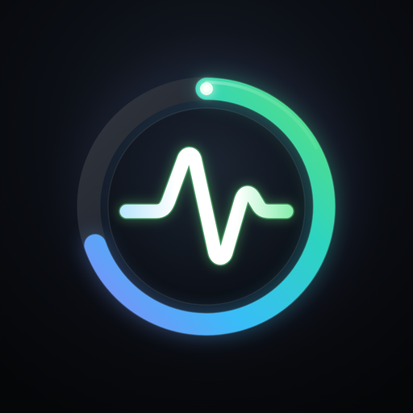

<div align="center">



# KADENZ · OpenHealth

**Local-First Gesundheits-, Erholungs-, Schlaf-, Trainings- & 0 € KI-Ernährungsintelligenz für Android & Web**

[](https://github.com/mixxermannipro/OpenHealth/releases/latest)
[](./LICENSE)
[-3DDC84?style=for-the-badge&logo=android&logoColor=white)](https://github.com/mixxermannipro/OpenHealth/releases/latest)
[](#-datenschutz--sicherheit)

**Kein Konto · Kein Abo · Keine Cloud · Keine Tracking-SDKs · Volle Kontrolle über deine Gesundheitsdaten**

[⬇️ Android APK herunterladen](https://github.com/mixxermannipro/OpenHealth/releases/latest) ·
[✨ Funktionen](#-funktionen-im-überblick) ·
[🤖 Android-Systemintegrationen](#-native-android-systemintegrationen) ·
[⌚ COROS, Uhren & Health Connect](#-uhren-coros--health-connect) ·
[🍽️ 0 € KI-Ernährung](#-0--ki-mahlzeiten-import-ohne-api-kosten) ·
[🛠️ Selbst bauen](#-lokale-entwicklung--apk-selbst-bauen) ·
[⚖️ Lizenz](#-lizenz-gnu-agpl-30)

</div>

---

## 📖 Was ist KADENZ (OpenHealth)?

**KADENZ (OpenHealth)** ist eine universelle, geräteunabhängige Gesundheits- und Trainingsplattform, die Erholung, Schlafphasen, Trainingsbelastung, langfristige Biomarker und Ernährung in einer ruhigen, präzisen Oberfläche zusammenführt – **vollständig lokal auf deinem Smartphone**.

Während klassische Fitness- und Recovery-Apps deine sensibelsten Körperdaten auf fremde Server hochladen, monatliche Abos verlangen oder dich an einen einzigen Hersteller binden, verfolgt KADENZ konsequent drei Prinzipien:

1. **100 % Local-First & Offline-fähig**: Deine gesamten Daten (Profile, Schlaf, HRV, Ruhepuls, Trainings, Mahlzeiten, Wasser, Check-ins) liegen ausschließlich in einer lokalen Datenbank (`IndexedDB` / Dexie) auf deinem eigenen Gerät.
2. **Geräteunabhängig über Android Health Connect & offene Standards**: Dauerhafte 15-Minuten-Hintergrundsynchronisation über **Android Health Connect** (bündelt COROS, Garmin, Polar, Samsung Health, Fitbit, Oura, Withings, Suunto u. v. m.) sowie direkter Datei-Import für **`.fit`**, **`.gpx`**, **`.tcx`**, **Apple Health `.xml`** und **Health Connect `.json`** inklusive automatischer Duplikaterkennung.
3. **0 € Betriebskosten für KI-Kalorientracking**: Nutze deine eigene KI-App (Gemini, ChatGPT, Claude) für Essensfotos oder Freitext und übergib das Ergebnis mit einem Tipp über das **Android Teilen-Menü**, die **Zwischenablage** oder per **Deep-Link** – ganz ohne API-Keys oder Serverkosten.

---

## ⬇️ Download & Installation auf Android

### 1. APK herunterladen
1. Öffne auf deinem Android-Handy die [**Releases-Seite**](https://github.com/mixxermannipro/OpenHealth/releases/latest).
2. Lade unter **Assets** die neueste Datei **`KADENZ-OpenHealth-v1.1.0.apk`** herunter.

### 2. APK installieren
1. Tippe nach dem Download auf die `.apk`-Datei in deinen Benachrichtigungen oder im *Downloads*-Ordner.
2. Falls Android nachfragt, aktiviere einmalig **„Aus dieser Quelle zulassen“** (für deinen Browser bzw. Dateimanager).
3. Tippe auf **Installieren** und starte **KADENZ**.

### 3. Dauerhaften Android Health Connect Sync & COROS einrichten
1. Öffne in KADENZ **Mehr → Datenquellen & Uhren → Health Connect** und erteile die Lese-, Hintergrund- (`READ_HEALTH_DATA_IN_BACKGROUND`) und Verlaufsberechtigungen (`READ_HEALTH_DATA_HISTORY`, bis 90 Tage).
2. Tippe anschließend auf **„Akku-Optimierung deaktivieren“**, damit Android (Samsung, Xiaomi, Pixel, OnePlus) den 15-Minuten-Hintergrund-Sync niemals im Schlaf beendet.
3. **Für COROS-Uhren**: Öffne die **COROS App → Profil → Einstellungen → Drittanbieter-Apps → Health Connect** (direkt aus KADENZ per 1-Tap-Button erreichbar) und aktiviere Schlaf, Herzfrequenz, Schritte, Distanz & Trainings. Alternativ kannst du einzelne Workouts direkt als **`.fit`** oder **`.gpx`** importieren.

---

## ✨ Funktionen im Überblick

### 1. Heute & Erholung (`TodayScreen`, `RecoveryScreen`)
- **Erholungswert (0–100 %)** auf Basis persönlicher 28-Tage-Baselines statt fremder Durchschnittswerte.
- **5 gewichtete Einflussfaktoren**: Nerven-Erholung (HRV / lnRMSSD), Schlaf & Schlafkonto, tägliches Körpergefühl (Check-in), Ruhepuls (RHR) und letzte Trainingsbelastung.
- **Adaptive Re-Gewichtung**: Fehlt ein Signal (z. B. ohne Wearable oder ohne Check-in), werden keine Werte erfunden – verfügbare Signale werden transparent neu gewichtet und die Datenkonfidenz klar ausgewiesen.
- **Tages-Empfehlung & Ziel-Belastung**: Konkrete Trainings- und Intensitätsempfehlung (inkl. Schutzregeln bei Krankheitssymptomen, starkem Muskelkater oder hohem Schlafdefizit).
- **Geführte Atemübungen** (*Box Breathing*, *4-7-8*, *Physiological Sigh*) & **Tages-Check-in-Journal** mit Habit-Korrelationsanalyse (z. B. Einfluss von spätem Koffein, Alkohol, Magnesium, Sauna/Kälte auf Schlaf & HRV).

### 2. Belastung & Training (`ActivityScreen`, `WorkoutDetailSheet`)
- **Tägliche Anstrengung (0–100)** sowie logarithmische **Strain-Skala (0,0–21,0)**.
- **Banister-TRIMP / Herzfrequenzreserve (HRR)** kombiniert mit **RPE (1–10)** für Sportarten wie Krafttraining, bei denen der Puls allein die Belastung unterschätzt.
- **5-Zonen-Herzfrequenzverteilung**, Tempo-/Puls-Zeitreihen und Kilometer-Splits.
- **Akute vs. chronische Belastung (7d / 28d EWMA-ACWR)** zur Vermeidung von Überlastung.
- **Interaktiver Trainings-Simulator („Was wäre wenn…“)**: Simuliere vorab einen Lauf oder ein Workout und sieh sofort die geschätzte Auswirkung auf Tages-Strain, 7-Tage-Last und die Erholung am Folgetag.

### 3. Schlaf & Erholungsarchitektur (`SleepScreen`, `SleepHypnogram`)
- **Schlafwert (0–100)** im 82/18-Hybridmodell (objektive Messdaten + subjektives Aufwachgefühl).
- **Interaktives Schlafphasen-Hypnogramm** (Wach, Leichtschlaf, Tiefschlaf, REM) direkt aus Health Connect oder manuell/importiert.
- **Schlafkonto & Zirkadianik**: Berechnung von Schlafdefizit, Schlafeffizienz, Regelmäßigkeit, empfohlener Zubettgehzeit und persönlichem Koffein-Stopp.

### 4. Ernährung & Adaptiver Kaloriencoach (`NutritionScreen`, `MealAnalyzeModal`)
- **0 € KI-Mahlzeiten-Import**: 1-Tap Prompt kopieren → Foto/Text in Gemini, ChatGPT oder Claude auswerten → direkt per **Android „Teilen“** oder **Zwischenablage** in KADENZ übernehmen. Der lokale Parser erkennt JSON, Markdown, Fließtext (DE/EN) und Deep-Links.
- **Universeller Barcode-Scanner & Open Food Facts**: Live-Kamera-Scanner für EAN-8, EAN-13, UPC-A, UPC-E und Code-128 + kostenlose Suche in Open Food Facts + kuratierte deutsche Offline-Basisdatenbank.
- **Wissenschaftliche Zielberechnung**: Mifflin-St-Jeor Grundumsatz, Wearables-NEAT oder manueller PAL-Modus, Zielgewicht mit Zeitprognose und automatischer Atwater-Kalorienprüfung.
- **Adaptiver TDEE-Kaloriencoach**: Glättet Gewichtsschwankungen über 14 Tage (EWMA-Gewichtstrend) und schlägt datengestützte Kalorienanpassungen vor.
- **Komfortfunktionen**: Favoriten (1-Tap), Mahlzeiten vom Vortag kopieren, Trinkmengen-Tracker (ml/L) und Gewichtstagebuch.

### 5. Körper, Fitnessalter & Langzeittrends (`HealthScreen`, `FitnessAgeScreen`, `MoreScreen`)
- **Fitnessalter-Schätzung** nach HUNT-Studie (VO₂max), altersnormierter lnRMSSD-HRV, Ruhepuls und Schlafkonsistenz inkl. 30-Tage-Verlauf.
- **Langfristige Biomarker-Trends** (7T, 30T, 90T, 6M): HRV, Ruhepuls, Schritte, VO₂max, SpO₂, Atemfrequenz, Körpergewicht & Körperfettanteil.
- **5 Sprachen nativ integriert**: Deutsch (`DE`), Englisch (`EN`), Spanisch (`ES`), Französisch (`FR`), Italienisch (`IT`).
- **Obsidian Dark Mode, Apple Light Mode & System-Theme** mit fließenden Animationen und haptischem Feedback.

---

## 🤖 Native Android-Systemintegrationen

KADENZ ist keine bloße WebView-Hülle, sondern integriert alle relevanten Android-Schnittstellen nativ in Kotlin (`android/app/src/main/java/io/github/mixxermannipro/openhealth/`):

| Android-Schnittstelle | Implementierung | Zweck in der App |
|---|---|---|
| **Android Health Connect (Vollsync)** | `HealthConnectPlugin.kt` + `HealthConnectSyncEngine.kt` (`connect-client:1.1.0`) | Liest **Schlaf inkl. Phasen** (Wach/Leicht/Tief/REM + intelligentes Zusammenführen geteilter Nächte), **HRV (RMSSD)**, **Ruhepuls** (+ automatische Nacht-Puls-Ableitung falls kein RHR-Record vorliegt), **Trainings** (inkl. echter HR-Zeitreihe, Distanz, Höhenmeter, Kadenz & Kalorien), **Schritte**, **aktive/gesamte Kalorien**, **VO₂max**, **SpO₂**, **Atemfrequenz**, **Hauttemperatur**, **Gewicht**, **Körperfett**, **Muskelmasse**, **Wasser** und **externe Mahlzeiten** + optionaler Schreib-Sync (Mahlzeiten, Wasser, Gewicht). |
| **Dauerhafter Hintergrund-Sync** | `HealthSyncWorker.kt` + `BootCompletedReceiver.kt` + `READ_HEALTH_DATA_IN_BACKGROUND` + `READ_HEALTH_DATA_HISTORY` | Synchronisiert alle **15 Minuten** zuverlässig im Hintergrund über `WorkManager`, überlebt Neustarts & App-Updates, bietet 1-Tap **Akku-Optimierung deaktivieren** und lädt bis zu **90 Tage Historie** für sofortige 28-Tage-Baselines. |
| **Health Connect Privacy Rationale** | `PermissionsRationaleActivity.kt` (`ACTION_SHOW_PERMISSIONS_RATIONALE` & `VIEW_PERMISSION_USAGE`) | Von Android 9–16 vorgeschriebene lokale Datenschutz-Erklärung direkt aus den Android-Systemeinstellungen aufrufbar. |
| **Android Share-Target (`ACTION_SEND`)** | `MainActivity.kt` + `KadenzNativePlugin.kt` | KADENZ erscheint nativ im Android-Teilen-Menü für `text/plain` (z. B. Antworten aus Gemini, ChatGPT, Claude) – funktioniert bei Kaltstart und laufender App (`singleTask` / `onNewIntent`). |
| **Custom Deep-Links (`ACTION_VIEW`)** | `caltrack://`, `kadenz://`, `web+caltrack://`, `web+kadenz://` | Direkter Import strukturierter Mahlzeiten-Links aus Shortcuts, Automationen (Tasker/MacroDroid) oder KI-Antworten. |
| **Launcher App-Shortcuts & Material You Icon** | `res/xml/shortcuts.xml` + `ic_launcher_monochrome.xml` | Modernes Obsidian-Liquid-Glass-Icon inkl. Android 13+ Material You Themed Icon sowie Langer-Druck-Shortcuts für *Mahlzeit erfassen* & *Schlaf ansehen*. |
| **Kamera-Barcode-Scanner** | `CAMERA`-Runtime-Permission + `BarcodeDetector` & **`@zxing/browser` Offline-Fallback** | Funktioniert auf **jedem** Android-Gerät (auch ohne Google Play Services / GrapheneOS) direkt im Live-Kamerabild für EAN-8, EAN-13, UPC-A, UPC-E & Code-128. |
| **Native Zwischenablage & Haptik** | `ClipboardManager` + `VibratorManager` (`EFFECT_TICK`, `EFFECT_CLICK`, Waveforms) | Zuverlässiges 1-Tap Kopieren/Einfügen & präzises taktiles Feedback ohne WebView-Einschränkungen. |
| **Nativer JSON-Backup-Export** | `FileProvider` + `Intent.ACTION_SEND` | Exportiert das komplette lokale Backup zuverlässig über das Android-Teilen-/Speichern-Menü (Downloads, Nextcloud, Drive, lokaler Speicher). |
| **Edge-to-Edge, System-Bars & Back-Taste** | `WindowCompat` + `WindowInsetsCompat` + `OnBackPressedCallback` | Saubere Anpassung an Statusleiste, Punch-Hole, Navigationsleiste (Dark/Light) sowie logische Zurück-Navigation durch Modals, Unterseiten und Tabs. |

---

## ⌚ Uhren, COROS & Health Connect

### COROS Uhren (PACE, APEX, VERTIX) kostenlos verbinden
Da die offizielle COROS Partner-API nur für kommerzielle Server-Plattformen mit bestehender Nutzerbasis freigegeben wird, bindet KADENZ COROS-Uhren **vollständig kostenlos und dauerhaft** über zwei Wege ein:
1. **Vollautomatisch über Android Health Connect**:
   - In der **COROS App**: *Profil → Einstellungen → Drittanbieter-Apps → Health Connect* aktivieren (Schlaf, Herzfrequenz, Schritte, Distanz & Trainings freigeben).
   - In **KADENZ**: *Mehr → Datenquellen & Uhren → Health Connect* verbinden, **Dauerhaften Hintergrund-Sync** erlauben und **Akku-Optimierung deaktivieren**.
   - KADENZ ordnet alle von der COROS App geschriebenen Daten automatisch als **COROS** zu, führt geteilte Schlafphasen sauber zusammen und leitet bei Bedarf sogar den nächtlichen Ruhepuls aus den gemessenen Nacht-Herzfrequenzdaten ab.
2. **Direkter `.FIT` / `.GPX` / `.TCX` Import**:
   - Exportiere einzelne Workouts direkt aus der COROS App (oder dem COROS Training Hub) als binäre **`.fit`**-Datei und importiere sie 100 % verlustfrei inkl. Herzfrequenz-Zeitreihe, Kadenz, Höhenmetern und Pace.

### Alle weiteren Wearables über Android Health Connect
KADENZ erkennt anhand der `dataOrigin.packageName`-Metadaten automatisch alle an Health Connect angeschlossenen Hersteller:
**COROS**, **Garmin** (`Garmin Connect`), **Polar** (`Polar Flow`), **Samsung Health**, **Fitbit**, **Oura**, **Suunto**, **Amazfit / Zepp**, **Withings** und **Google Fit / Health Connect**.

### Direkter Datei-Import (Offene Standards)
Unter **Mehr → Datenquellen & Uhren → Offener Datei-Import** kannst du jederzeit lokale Exportdateien einlesen:
- **`.fit`** (Binäre COROS-, Garmin-, Polar- & Suunto-Workouts inkl. HR-Zeitreihe, Höhenmeter & Kadenz)
- **`.gpx`** (GPS-Tracks inkl. Herzfrequenz-Extensions, Höhenmeter & Distanz)
- **`.tcx`** (Training Center XML – Garmin, COROS, Polar)
- **`.xml`** (Apple Health `export.xml` – Trainings, Schlaf, HRV, Ruhepuls)
- **`.json`** (Health Connect Exporte)

### Intelligente Duplikaterkennung
Wenn zwei Quellen dasselbe Training aufzeichnen (z. B. `.fit`-Import + Health Connect), verhindert `mergeSyncedBatch` doppelte Belastungszählung anhand von Sportart, Startzeitfenster (±20 Min.), Dauer (±15 %) und Distanz (±0,45 km) – stets unter Berücksichtigung deiner gewählten Quellenpriorität.

---

## 🍽️ 0 € KI-Mahlzeiten-Import (ohne API-Kosten)

KADENZ verzichtet bewusst auf kostenpflichtige KI-APIs und nutzt stattdessen deinen bereits vorhandenen KI-Assistenten:

1. Tippe im Tab **Essen → KI-Import** auf **„Prompt“** (kopiert die optimierte Vorlage in die Zwischenablage).
2. Sende ein Foto oder eine Beschreibung deiner Mahlzeit samt Prompt an **Gemini**, **ChatGPT** oder **Claude**.
3. Tippe in der KI-App auf **Teilen → KADENZ** (Android Share-Intent) oder kopiere die Antwort und tippe in KADENZ auf **Zwischenablage**.
4. KADENZ parst JSON, Markdown, freien Text oder Deep-Links 100 % lokal offline, prüft die Makro-Plausibilität (Atwater) und lässt dich alle Werte vor dem Speichern kurz feinjustieren.

Unterstütztes Deep-Link-Schema für eigene Automationen:
```text
caltrack://log?name=Skyr%20mit%20Beeren&kcal=380&p=36&c=42&f=6&category=breakfast
```

---

## 🔬 Wissenschaftliche Methodik

Alle Algorithmen sind deterministisch, transparent im Quellcode einsehbar (`src/engine/`) und direkt in der App über Info-Buttons erklärt:

- **HRV-Auswertung**: Logarithmierte RMSSD (`lnRMSSD`) als Z-Score gegen deinen rollierenden 28-Tage-Durchschnitt (*Plews et al., 2013*).
- **Subjektive Erholungs-Gewichtung**: Einbindung von Energie, Schlafgefühl, Muskelkater, Müdigkeit und Stress (*Saw, Main & Gastin, 2016, Br J Sports Med*).
- **Trainingsbelastung**: Exponentieller Banister-TRIMP über Herzfrequenzreserve (HRR) + RPE-Hybridmodell für Krafttraining, abgebildet auf 0–100 und logarithmischen Strain 0–21; akute (7T) zu chronischer (28T) Last mittels EWMA-ACWR.
- **Maximale Herzfrequenz**: Alter automatisch aus Geburtsdatum berechnet + Tanaka-Formel (`HRmax = 208 − 0,7 × Alter`, *JACC 2001*), jederzeit manuell überschreibbar.
- **Fitnessalter**: Basierend auf der HUNT Fitness Study (*Nes et al., 2014*) erweitert um altersnormierte HRV (*Shaffer & Ginsberg, 2017*) und Schlafkonsistenz.
- **Energie- & Makroplanung**: Mifflin-St-Jeor BMR + NEAT/Wearable- oder PAL-Modus + 14-Tage-EWMA-Trendcoach.

> **Medizinischer Hinweis**: KADENZ dient der persönlichen Fitness-, Trainings- und Gesundheitsorientierung und ersetzt keine medizinische Diagnose oder ärztliche Beratung.

---

## 🏗️ Architektur & Projektstruktur

```text
OpenHealth/
├── src/
│   ├── App.tsx                       # App-Einstieg, Navigation, Back-Button, Share-Intents, Auto-Sync
│   ├── engine/
│   │   ├── calculations.ts           # Erholung, Schlaf, TRIMP/Strain, ACWR, Fitnessalter, Korrelationen
│   │   ├── nutrition.ts              # Mifflin-St-Jeor, Makros, EWMA-Gewichtstrend & Adaptiver Coach
│   │   └── aiMealParser.ts           # 0 € lokaler Parser (JSON, Freitext DE/EN, Deep-Links)
│   ├── services/
│   │   ├── androidBridge.ts          # Typisierte Capacitor-Bridge für alle nativen Android-Plugins
│   │   ├── mealShareReceiver.ts      # Share-Intent, Deep-Link & Shortcut Empfänger (Android + Web)
│   │   └── openFoodFacts.ts          # Open Food Facts API + lokale Offline-Lebensmittelbasis
│   ├── providers/
│   │   ├── healthProviders.ts        # Deduplizierung & Multi-Quellen-Merge-Engine
│   │   └── fileImporters.ts          # Parser für GPX, TCX, Apple Health XML & Health Connect JSON
│   ├── db/database.ts                # Lokale Dexie/IndexedDB-Datenbank + Backup-Validierung
│   ├── store/useHealthStore.ts       # Zentraler Zustand (Zustand + Persistenz + Health Connect Sync)
│   ├── components/                   # Screens, Charts (Recharts) & Liquid-Glass UI-Komponenten
│   ├── i18n/                         # Vollständige Übersetzungen (DE, EN, ES, FR, IT)
│   └── utils/                        # Haptik, Biometrie, Datums- & Zahlenformatierung
├── android/
│   └── app/src/main/
│       ├── AndroidManifest.xml       # Permissions, Health Connect, Share-Target, Deep-Links, Shortcuts
│       ├── res/                      # Adaptive Icons, Obsidian Splash, Shortcuts, FileProvider-Pfade
│       └── java/io/github/mixxermannipro/openhealth/
│           ├── MainActivity.kt               # Edge-to-Edge, Intents, Back-Handling, Plugin-Registrierung
│           ├── HealthConnectPlugin.kt        # Native Jetpack Health Connect 1.1.0 Integration
│           ├── KadenzNativePlugin.kt         # Clipboard, Haptik, Kamera-Rechte, Export, WorkManager
│           ├── PermissionsRationaleActivity.kt # Pflicht-Datenschutz-Dialog für Health Connect
│           └── HealthSyncWorker.kt           # WorkManager Periodischer Sync-Checkpoint
├── capacitor.config.ts               # Capacitor-Konfiguration (https://kadenz.local)
├── .github/workflows/                # GitHub Actions CI für Tests & automatische Android-Builds
└── LICENSE                           # GNU Affero General Public License v3.0 (AGPL-3.0)
```

---

## 🛠️ Lokale Entwicklung & APK selbst bauen

### Voraussetzungen
- **Bun** (empfohlen) oder **Node.js 22+**
- Für Android-APKs zusätzlich: **Java 21 (JDK 21)** und **Android SDK** (API 35/36, `ANDROID_HOME` gesetzt)

### 1. Abhängigkeiten installieren & Web-App starten
```bash
git clone https://github.com/mixxermannipro/OpenHealth.git
cd OpenHealth
bun install
bun run dev
```

### 2. Typprüfung & Unit-Tests ausführen
```bash
bun run lint   # TypeScript Strict Check (tsc --noEmit)
bun run test   # Alle Engine-, Parser-, Importer- & Deduplizierungs-Tests
```

### 3. Android Debug-APK bauen
```bash
bun run build
npx cap sync android
cd android && ./gradlew assembleDebug
```
Die fertige Debug-APK liegt unter `android/app/build/outputs/apk/debug/app-debug.apk`.

### 4. Signierte Android Release-APK bauen
Lege außerhalb des Repositories einen eigenen Signing-Keystore an (niemals in Git einchecken!) und übergib die Daten per Umgebungsvariablen oder `android/keystore.properties`:

```bash
export KEYSTORE_PATH=/pfad/zu/deinem-release.jks
export KEYSTORE_PASSWORD="DEIN_STORE_PASSWORT"
export KEY_ALIAS="kadenz-release"
export KEY_PASSWORD="DEIN_KEY_PASSWORT"

bun run build
npx cap sync android
./android/gradlew -p android assembleRelease
```
Die signierte APK entsteht unter `android/app/build/outputs/apk/release/app-release.apk`.

---

## 🔒 Datenschutz & Sicherheit

- **Keine eigenen Server & kein Account-Zwang**: Alle Gesundheits-, Schlaf-, Trainings- und Ernährungsdaten verbleiben ausschließlich lokal auf deinem Gerät.
- **Keine Telemetrie, kein Analytics, keine Werbung**: Null Tracking-Bibliotheken im Web- wie im nativen Android-Code.
- **HTTPS-only (`usesCleartextTraffic="false"`)**: Netzwerkzugriff erfolgt ausschließlich optional, wenn du aktiv in **Open Food Facts** nach einem Lebensmittel oder Barcode suchst.
- **Lokales Backup & Löschung jederzeit**: Vollständiger JSON-Export über Android-Dateiauswahl/Teilen sowie 1-Klick-Datenlöschung unter **Mehr → App & Datensicherung**.

---

## ⚖️ Lizenz (GNU AGPL-3.0)

Dieses Projekt steht unter der **GNU Affero General Public License v3.0 (AGPL-3.0)** – siehe vollständigen Lizenztext in [`LICENSE`](./LICENSE).

### Was das konkret bedeutet:
- ✅ **Einsehen & prüfen**: Jeder darf den gesamten Quellcode frei lesen, auditieren und für sich selbst bauen.
- ✅ **Mitwirken**: Pull Requests, Bugfixes und Verbesserungen durch die Community sind willkommen.
- ❌ **Kein einfaches Copy-Paste als geschlossene/eigene App**: Niemand darf diesen Code einfach kopieren, umbenennen oder als Closed-Source-App bzw. gehosteten Dienst weiterverbreiten.
- ⚖️ **Strenges Copyleft & Namensnennung**: Jede Weiterverbreitung, Veränderung oder Netzwerknutzung (auch als Web-App/SaaS) **muss** den ursprünglichen Copyright-Hinweis behalten, alle Änderungen dokumentieren und den vollständigen Quellcode ebenfalls unter der **GNU AGPL-3.0** offenlegen.

---

<div align="center">
  <sub>Entwickelt für maximale Datensouveränität · <a href="https://github.com/mixxermannipro/OpenHealth/releases/latest">Neueste Android-APK herunterladen</a></sub>
</div>
